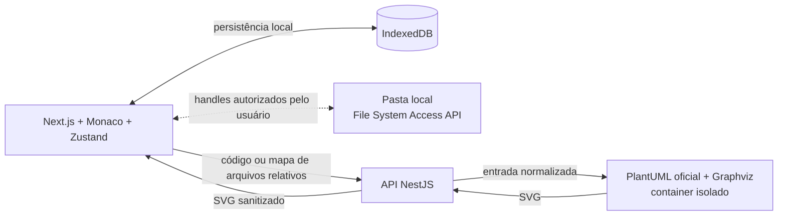

# PlantUML Studio

Editor web para criar, organizar, renderizar e explorar diagramas PlantUML com uma experiência próxima à de uma IDE.

O projeto combina edição de código com Monaco Editor, renderização local pelo motor oficial do PlantUML, navegação interativa em SVG e suporte a projetos modulares. Todo o fluxo foi pensado para funcionar sem depender de servidores públicos de renderização e sem enviar caminhos locais do usuário ao backend.

## Sobre o projeto

O PlantUML Studio nasceu para tornar o trabalho com diagramas como código mais confortável em projetos reais. Além de editar um arquivo isolado, a aplicação permite trabalhar com múltiplos documentos, estruturas de diretórios, diretivas `!include` e pastas locais vinculadas ao navegador.

O código PlantUML permanece como fonte de verdade. O canvas é responsável apenas pela visualização e pela navegação, sem alterar automaticamente o conteúdo do diagrama.

## Principais funcionalidades

### Editor de código

- Monaco Editor com syntax highlighting para PlantUML.
- Autocomplete das principais diretivas.
- Numeração de linhas, indentação automática, undo/redo e atalhos de edição.
- Abas para alternar entre documentos.
- Criação, renomeação e exclusão de arquivos.
- Indicadores de alterações não salvas e estado de salvamento.
- Gerenciamento de documento ativo isolado por projeto.

### Renderização PlantUML

- API REST em NestJS integrada ao motor oficial PlantUML e ao Graphviz.
- Preview automático com debounce de 400 ms.
- Cancelamento ou descarte de respostas obsoletas.
- Tratamento de erros de sintaxe e renderização.
- Preservação do último SVG válido quando uma nova renderização falha.
- Sanitização do SVG antes da exibição.
- Renderizador executado de forma isolada em Docker, sem dependência de servidores públicos.

### Canvas interativo

- Zoom com roda do mouse, touchpad e gesto de pinça.
- Pan por arraste, botão central do mouse ou `Espaço` + arraste.
- Controles de zoom, reset e Fit to Screen.
- Indicador percentual de zoom.
- Preservação do enquadramento durante atualizações do SVG, quando possível.
- Modo de visualização em tela cheia.
- Navegação fluida em diagramas grandes sem perda de nitidez.

### Projetos e arquivos

- Projetos independentes, cada um com seus próprios arquivos, abas e estado de edição.
- Seletor para criar, abrir, alternar e fechar projetos.
- Importação de arquivos `.puml`, `.plantuml` e `.pu`.
- Importação de pastas completas preservando a estrutura de diretórios.
- Suporte a `!include`, `!include_once` e `!include_many` com caminhos relativos.
- Resolução de imports aninhados, ausentes e circulares.
- Seleção de um arquivo principal e preview temporário de qualquer arquivo ao selecioná-lo.
- Persistência no navegador com IndexedDB e salvamento automático.
- Abertura e edição de pastas locais pela File System Access API em navegadores compatíveis.
- `Ctrl+S` para salvar o arquivo ativo e ação para salvar todos os arquivos.
- Proteção contra sobrescrita silenciosa de arquivos alterados externamente.

### Importação e exportação

- Exportação do código original em `.puml`.
- Exportação do diagrama em SVG.
- Exportação em PNG com escala configurável.
- SVG e PNG exportados contêm somente o diagrama, sem os controles do canvas.

### Interface

- Layout desktop com explorador, editor e preview redimensionáveis.
- Temas claro e escuro.
- Estados visuais de carregamento, erro e conteúdo vazio.
- Navegação por teclado e cuidados básicos de acessibilidade.

## Arquitetura



O frontend nunca envia caminhos absolutos nem handles do sistema de arquivos ao backend. Em projetos modulares, a API recebe apenas um mapa de arquivos com caminhos relativos ao projeto e resolve os imports dentro de um ambiente temporário e isolado.

O estado da aplicação é dividido entre:

- interface e sessão de edição, gerenciadas com Zustand;
- projetos internos e metadados persistidos em IndexedDB;
- arquivos locais, acessados somente após autorização explícita do navegador;
- renderização, executada pela API e pelo container do PlantUML.

## Tecnologias

| Camada | Tecnologias |
| --- | --- |
| Frontend | Next.js 16, React 19, TypeScript, Monaco Editor, Zustand, react-zoom-pan-pinch |
| Backend | NestJS 12, TypeScript, API REST |
| Renderização | PlantUML oficial, Graphviz, SVG |
| Persistência | IndexedDB e File System Access API |
| Infraestrutura | Docker e Docker Compose |
| Monorepo | pnpm workspaces |

## Como executar

### Pré-requisitos

- Node.js `24.19.0` — a versão também está registrada em `.nvmrc`.
- pnpm `12.9.1`.
- Docker com Docker Compose.

Se você utiliza `nvm` e Corepack:

```bash
nvm use
corepack enable
pnpm install --frozen-lockfile
```

### Execução recomendada

Suba a API e o renderizador isolado:

```bash
pnpm renderer:up
```

Em outro terminal, inicie o frontend:

```bash
pnpm --filter @plantuml-studio/web dev
```

Acesse:

- Aplicação: [http://127.0.0.1:3000](http://127.0.0.1:3000)
- API: [http://127.0.0.1:3001](http://127.0.0.1:3001)

Para encerrar os containers:

```bash
pnpm renderer:down
```

As configurações padrão funcionam para esse fluxo local. As variáveis disponíveis estão documentadas em `.env.example`:

```env
NEXT_PUBLIC_API_URL=http://127.0.0.1:3001
WEB_ORIGIN=http://127.0.0.1:3000
PLANTUML_RENDERER_URL=http://127.0.0.1:8080
RENDER_TIMEOUT_MS=5000
```

> A File System Access API depende de um navegador compatível e de um contexto seguro. Durante o desenvolvimento, `localhost` e `127.0.0.1` são aceitos pelos navegadores compatíveis.

## Comandos úteis

```bash
# Desenvolvimento do frontend e da API locais
pnpm dev

# Verificação de tipos
pnpm typecheck

# Análise estática
pnpm lint

# Build de produção
pnpm build

# Build seguido dos testes existentes
pnpm test
```

Ao usar `pnpm dev`, o motor PlantUML ainda precisa estar disponível no endereço definido por `PLANTUML_RENDERER_URL`. Para o fluxo integrado completo, prefira executar a API e o renderizador pelo Docker e iniciar somente o frontend localmente, conforme descrito acima.

## Estrutura do monorepo

```text
.
├── apps/
│   ├── api/        # API NestJS e integração com o renderizador
│   └── web/        # Aplicação Next.js, editor e canvas
├── packages/
│   └── shared/     # Contratos e tipos compartilhados
├── docs/           # Produto, arquitetura, design, roadmap e decisões
├── tests/          # Testes de integração/smoke existentes
└── docker-compose.yml
```

## Segurança do renderizador

O processamento de PlantUML é tratado como uma operação não confiável. O ambiente Docker aplica limites e restrições como:

- container sem privilégios adicionais;
- filesystem somente leitura, com áreas temporárias controladas;
- limites de CPU, memória, processos e tempo de execução;
- renderizador sem porta pública e isolado em uma rede interna;
- sanitização do SVG antes de enviá-lo ao navegador;
- resolução de imports restrita aos arquivos fornecidos pelo projeto ativo.

Essas medidas reduzem a superfície de ataque, mas não substituem uma revisão de segurança antes de disponibilizar uma instância pública para usuários não confiáveis.

## Estratégia de desenvolvimento com agentes de IA

Este projeto foi construído com desenvolvimento assistido por IA e supervisão humana contínua. A estratégia não foi pedir que um agente gerasse toda a aplicação de uma só vez, mas dividir o produto em fases verificáveis e oferecer contexto persistente para cada tarefa.

### 1. Documentação como memória compartilhada

Os agentes consultam arquivos versionados antes de implementar mudanças:

- [`PRODUCT.md`](docs/PRODUCT.md): objetivos e requisitos do produto;
- [`ARCHITECTURE.md`](docs/ARCHITECTURE.md): limites técnicos e responsabilidades;
- [`DESIGN_SYSTEM.md`](docs/DESIGN_SYSTEM.md): padrões visuais e de interação;
- [`ROADMAP.md`](docs/ROADMAP.md): fases e estado da implementação;
- [`DECISIONS.md`](docs/DECISIONS.md): decisões arquiteturais e suas justificativas;
- [`AGENTS.md`](AGENTS.md): regras operacionais para os agentes.

Isso reduz perda de contexto entre sessões e evita que uma nova tarefa contradiga decisões já aceitas.

### 2. Implementação incremental por fases

O roadmap separa o trabalho em entregas pequenas: fundação, design system, editor, renderização, canvas, persistência, projetos modulares e acesso a pastas locais. Cada fase define escopo e restrições explícitas, mantendo funcionalidades futuras fora da implementação atual.

### 3. Papéis especializados por skill

O repositório contém instruções especializadas para diferentes tipos de trabalho:

- frontend, para componentes e integração da interface;
- UI/UX, para fluxos, acessibilidade e consistência visual;
- qualidade de código, para revisão de TypeScript, React e NestJS.

Um agente principal seleciona a especialidade adequada à tarefa, segue as mesmas fontes de verdade e registra decisões relevantes. Essa abordagem torna o comportamento do agente mais previsível sem remover a responsabilidade humana sobre produto e arquitetura.

### 4. Humano no circuito

As decisões de produto, a aprovação entre fases e a validação visual permaneceram com o responsável pelo projeto. Feedbacks obtidos ao usar a interface — como legibilidade no tema escuro e preview de arquivos que não são o principal — foram convertidos em ajustes específicos, em vez de refatorações amplas.

### 5. Verificação baseada em evidências

O fluxo esperado para cada mudança é:

1. ler a documentação relevante;
2. inspecionar o código existente;
3. delimitar e apresentar um plano curto;
4. implementar somente o escopo solicitado;
5. executar as verificações relevantes;
6. registrar resultados e atualizar a documentação.

Os agentes são instruídos a não declarar sucesso de testes, lint, typecheck ou build sem executá-los. Ferramentas de navegador também são usadas quando a validação depende do comportamento visual ou de interação.

## Estado atual

O MVP cobre as oito fases planejadas, da base do monorepo ao gerenciamento de projetos independentes e integração opcional com pastas locais. A evolução e as decisões técnicas podem ser acompanhadas em [`ROADMAP.md`](docs/ROADMAP.md) e [`DECISIONS.md`](docs/DECISIONS.md).

Ficam intencionalmente fora do escopo atual:

- edição visual de classes, nós ou relacionamentos;
- autenticação;
- banco de dados remoto;
- sincronização em nuvem;
- backend com acesso direto ao computador do usuário.

## Documentação

- [Visão de produto](docs/PRODUCT.md)
- [Arquitetura](docs/ARCHITECTURE.md)
- [Design System](docs/DESIGN_SYSTEM.md)
- [Roadmap](docs/ROADMAP.md)
- [Decisões arquiteturais](docs/DECISIONS.md)

